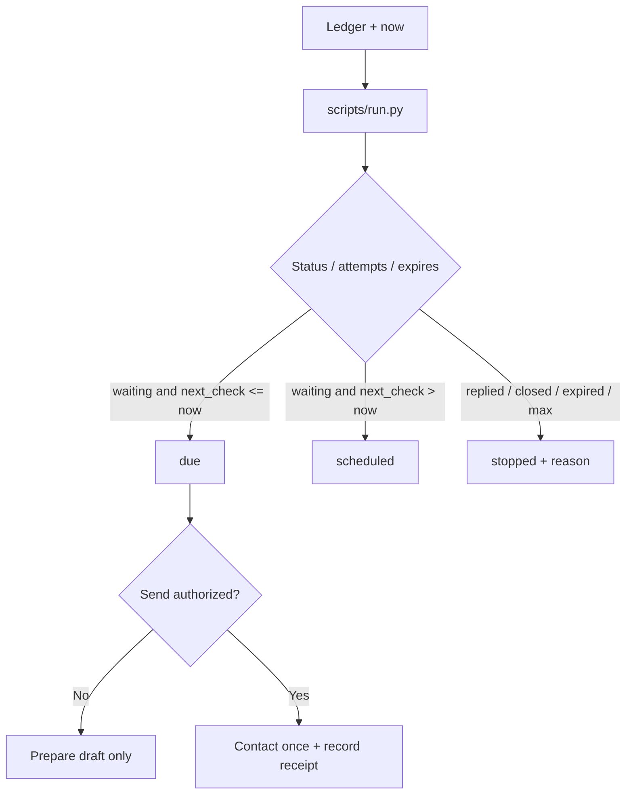

# Follow-up Tracker

[English](README.md) · [中文](README.zh-CN.md) · **v0.2.1**

[](https://github.com/KarmenLoop/skill-follow-up-tracker/releases/latest)
[](https://www.python.org/downloads/)
[](LICENSE)
[](skill.json)
[](SKILL.md)

**Surface who is due for follow-up—and who should stop—from an outreach ledger you control.**

Outreach collapses when “ping them again” has no stop condition. **Follow-up Tracker** is a portable agent skill plus a local Python helper that reads contacts with `next_check`, attempt counts, and statuses, compares them to `now`, and emits `due`, `scheduled`, and `stopped` (replied / closed / expired / attempt-capped). A reminder becoming due **does not** authorize a new message—the helper never contacts a recipient.

Built and maintained by [KarmenLoop](https://github.com/KarmenLoop) / [KARMENLOOP](https://karmenloop.com). Current release: **[v0.2.1](https://github.com/KarmenLoop/skill-follow-up-tracker/releases/tag/v0.2.1)**. License: **MIT**.


*Actual local output from v0.2.1, rendered as an image. [Complete result](examples/expected.json) · [Image provenance](docs/images/provenance.json).*

[Download v0.2.1](https://github.com/KarmenLoop/skill-follow-up-tracker/releases/tag/v0.2.1) · [Tutorial](docs/tutorial.en.md) · [中文教程](docs/tutorial.zh-CN.md) · [Input contract](docs/INPUT.md)

---

## Why this exists

Agents schedule forever. This package forces finite `max_attempts`, explicit stop reasons, and a clean split between preparing a draft and sending. No scheduler or messaging connector is bundled.

---

## Snapshot

| | |
|---|---|
| **What you install** | Portable skill (`SKILL.md`, docs, examples) + local helper under `scripts/` |
| **Package name** | `karmen-follow-up-tracker` |
| **Version** | **0.2.1** (`skill.json`, release tag, `--version`) |
| **Runtime** | Python **3.9+**, standard library only |
| **Network** | Helper: **offline** (`"network": false` in `skill.json`) |
| **Entry** | `python3 scripts/run.py --input …` · optional `python3 install.py --host agents` |
| **Sample artifact** | [examples/input.json](examples/input.json) → [examples/expected.json](examples/expected.json) |
| **License** | [MIT](LICENSE) — keep [NOTICE.md](NOTICE.md) with redistributed copies |

---

## Is / Is not

| Is | Is not |
|---|---|
| Due / scheduled / stopped queues from a ledger | Email / SMS / CRM sender |
| Stop on replied, closed, expired, max attempts | Infinite reminder loop |
| Offset-aware `next_check` vs `now` | Background cron (host must add) |
| Portable skill + stdlib helper | Full CRM platform |
| Draft prep guidance without send authority | Unattended outreach automation without extra host setup |

---

## How it works

1. **Method layer** — confirm campaign/relationship; prefer real receipts over local assumptions; set next-check from urgency and intent; contact only if authorized; then record the receipt.
2. **Helper** — pure time/status rules → due queue, future checks, stop reasons.

### Flow



### Sample (v0.2.1)

Waiting **Example partner** is **due**; **Former lead** marked `replied` moves to **stopped** with `stop_reason: replied`. See [examples/expected.json](examples/expected.json).

---

## Quickstart

### A. Run the helper (no agent host required)

1. Download `karmen-follow-up-tracker-v0.2.1.zip` and its `.sha256` from the [v0.2.1 release](https://github.com/KarmenLoop/skill-follow-up-tracker/releases/tag/v0.2.1).
2. Verify the hash, then extract.
3. In the extracted directory, with Python 3.9+:

```sh
python3 scripts/run.py --version
python3 scripts/run.py --input examples/input.json
```

Expected version string: `karmen-follow-up-tracker 0.2.1`. JSON lands on stdout. Use `--output new-result.json` to keep a copy without overwriting existing files. Pipe mode: `--input -`.

### B. Install the portable skill

For hosts that read `~/.agents/skills` (or a project `.agents/skills`):

```sh
python3 install.py --host agents
```

The installer **refuses an existing destination**—use a fresh path or remove the old copy first. Host discovery and invocation vary; see [docs/tutorial.en.md](docs/tutorial.en.md). You can keep using the helper directly without any AI host.

### Use it with your own work

- Use offset-aware `next_check` and `now` values.
- Record attempts accurately; set a finite `max_attempts`; use `expires` when a real deadline exists.
- Investigate inconsistent dates rather than scheduling around them.
- Never treat “due” as permission to message.

Read [docs/INPUT.md](docs/INPUT.md) before preparing new input. The helper needs no model account, API key, or network connection. An AI host has its own data and permission settings; this skill adds no authority to send, purchase, publish, or change access.

---

## Documentation map

| Doc | Use it when you need… |
|---|---|
| [Tutorial (EN)](docs/tutorial.en.md) · [中文](docs/tutorial.zh-CN.md) | Download, install, practice, upgrade, remove |
| [INPUT.md](docs/INPUT.md) · [input.zh-CN.md](docs/input.zh-CN.md) | Field contract |
| [COMPATIBILITY.md](docs/COMPATIBILITY.md) | Host / runtime notes |
| [VALIDATION.md](docs/VALIDATION.md) | What checks cover |
| [SOURCES.md](docs/SOURCES.md) | Provenance pointers |
| [CHANGELOG.md](CHANGELOG.md) | History through 0.2.1 |
| [SECURITY.md](SECURITY.md) / [SUPPORT.md](SUPPORT.md) / [CONTRIBUTING.md](CONTRIBUTING.md) | Ops |

---

## FAQ

### What is Follow-up Tracker in one sentence?

A MIT-licensed agent skill and offline helper that turns an outreach ledger into due, scheduled, and stopped queues—without contacting anyone.

### Will it email or message people?

No. Preparing a draft and sending remain separate. The skill adds no send authority.

### Is there a built-in scheduler?

No. Unattended checks need host automation you configure yourself.

### What stop reasons exist?

Including replied, closed, expired, and attempt-capped—see the input contract for the full set.

### Where does output go?

JSON to stdout by default, or `--output` to a new file.

### Soft discoverability

Useful phrases: **follow-up due queue for agents**, **outreach stop conditions**, **offline CRM reminder triage**, **max-attempts follow-up ledger**. Avoid stuffing; the substance is in the skill and helper, not keyword density.

---

## License and contact

[MIT](LICENSE). Keep the license and [NOTICE.md](NOTICE.md) with redistributed copies.

Maintainer: [KarmenLoop](https://github.com/KarmenLoop) · Site: [karmenloop.com](https://karmenloop.com)

Issues: [GitHub Issues](https://github.com/KarmenLoop/skill-follow-up-tracker/issues) · Support policy: [SUPPORT.md](SUPPORT.md). Prefer synthetic data when filing example bugs.
