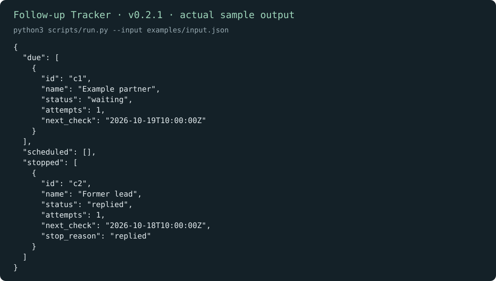

# Follow-up Tracker

English | [简体中文](README.zh-CN.md)

Keep track of conversations that are still waiting for an answer. Review what is due, what is scheduled, and what should stop because it was answered, closed, expired, or reached its attempt limit.

[Download v0.2.1](https://github.com/KarmenLoop/skill-follow-up-tracker/releases/tag/v0.2.1) · [Tutorial](docs/tutorial.en.md) · [Input reference](docs/INPUT.md) · [Report an issue](https://github.com/KarmenLoop/skill-follow-up-tracker/issues)

## What it does

The waiting partner is due for review; the contact marked replied moves to stopped.

This package does not contact people or run a background schedule. You supply next_check and the current time; any outreach remains a separate decision.



*Actual local output from v0.2.1, rendered as an image. [Complete result](examples/expected.json) · [Image provenance](docs/images/provenance.json).*

## Start here

Download `karmen-follow-up-tracker-v0.2.1.zip` and its `.sha256` file from the release, verify the hash, then extract the ZIP. In the extracted directory, use Python 3.9 or later:

```sh
python3 scripts/run.py --version
python3 scripts/run.py --input examples/input.json
```

Expected version: `karmen-follow-up-tracker 0.2.1`. The waiting partner is due for review; the contact marked replied moves to stopped.

To install the complete skill into a host that reads `~/.agents/skills`:

```sh
python3 install.py --host agents
```

The installer refuses an existing destination. Host discovery and invocation vary; see the [full setup and practice guide](docs/tutorial.en.md). You can run the helper directly without an AI host.

## Use it with your own work

Use offset-aware next_check and now values. Record attempts accurately, set a finite max_attempts, and use expires when a request has a real deadline.

Change the sample to closed, then try an expired deadline and an exhausted attempt count. Inspect stop_reason before preparing any further contact.

Read the [field contract](docs/INPUT.md) before preparing a new input. The helper runs locally with the Python standard library; it needs no model account, API key, or network connection. An AI host has its own data and permission settings.

## Questions

**Can it email someone automatically?** No. It produces a review list. Sending requires a separate communication tool and the appropriate authorization.

**Where does the result go?** JSON is printed to stdout unless you request a new file with `--output`. Existing output files are preserved. The helper reads only the submitted records and any local paths documented in its input contract.

## Documentation and support

- [Download, install, configure, practice, upgrade, and remove](docs/tutorial.en.md)
- [Input/output contract](docs/INPUT.md) and [compatibility](docs/COMPATIBILITY.md)
- [Changelog](CHANGELOG.md), [contributing](CONTRIBUTING.md), [support](SUPPORT.md), and [security reports](SECURITY.md)

## License

[MIT](LICENSE). Keep the license and [notice](NOTICE.md) with redistributed copies. Maintained by [KarmenLoop](https://karmenloop.com).
