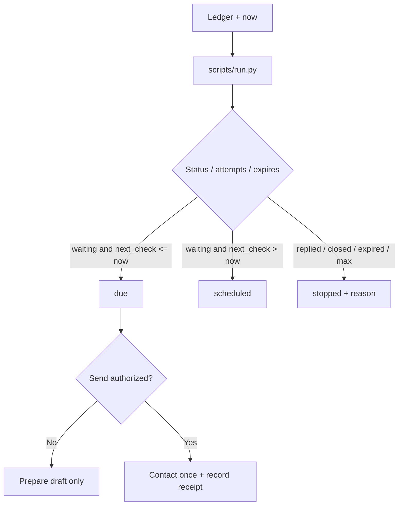

# 跟进清单 · Follow-up Tracker

[English](README.md) · [中文](README.zh-CN.md) · **v0.2.1**

[](https://github.com/KarmenLoop/skill-follow-up-tracker/releases/latest)
[](https://www.python.org/downloads/)
[](LICENSE)
[](skill.json)
[](SKILL.md)

**从你掌控的触达台账里，标出该复查谁、该停止跟进谁。**

没有停止条件的“再催一下”，会把触达拖垮。**跟进清单**是可移植的 Agent Skill，外加本地 Python 助手：读取带 `next_check`、尝试次数与状态的联系人，与 `now` 比较后输出 `due`、`scheduled` 与 `stopped`（已回复 / 关闭 / 过期 / 达次数上限）。到期**不等于**授权发新消息——助手从不联系收件人。

由 [KarmenLoop](https://github.com/KarmenLoop) / [KARMENLOOP](https://karmenloop.com) 维护。当前发行版：**[v0.2.1](https://github.com/KarmenLoop/skill-follow-up-tracker/releases/tag/v0.2.1)**。许可：**MIT**。


*图片来自 v0.2.1 的真实本地输出（英文键名）。[完整结果](examples/expected.json) · [图片来源记录](docs/images/provenance.json)。*

[下载 v0.2.1](https://github.com/KarmenLoop/skill-follow-up-tracker/releases/tag/v0.2.1) · [中文教程](docs/tutorial.zh-CN.md) · [English tutorial](docs/tutorial.en.md) · [输入契约](docs/input.zh-CN.md)

---

## 为什么需要它

代理容易无限排期。本包强制有限的 `max_attempts`、显式停止原因，并严格区分“准备草稿”与“发送”。不附带调度器或消息连接器。

---

## 一览

| | |
|---|---|
| **安装内容** | 可移植 Skill（`SKILL.md`、文档、样例）+ `scripts/` 下本地助手 |
| **包名** | `karmen-follow-up-tracker` |
| **版本** | **0.2.1**（`skill.json`、发行标签、`--version`） |
| **运行时** | Python **3.9+**，仅标准库 |
| **网络** | 助手：**离线**（`skill.json` 中 `"network": false`） |
| **入口** | `python3 scripts/run.py --input …` · 可选 `python3 install.py --host agents` |
| **样例产物** | [examples/input.json](examples/input.json) → [examples/expected.json](examples/expected.json) |
| **许可** | [MIT](LICENSE) — 再分发时保留 [NOTICE.md](NOTICE.md) |

---

## 是 / 不是

| Is | Is not |
|---|---|
| 由台账得到 due / scheduled / stopped 队列 | 邮件 / 短信 / CRM 发送器 |
| 在已回复、关闭、过期、达上限时停止 | 无限提醒循环 |
| 带偏移的 `next_check` 对比 `now` | 后台 cron（需宿主另加） |
| 可移植 Skill + 标准库助手 | 完整 CRM 平台 |
| 指导准备草稿但不授予发送权 | 无需额外配置的无人值守触达 |

---

## 如何工作

1. **方法层** — 确认活动/关系；优先真实回执而非本地臆测；按紧急度与意图设下次检查；仅在已授权时联系，并记录回执。
2. **助手** — 纯时间/状态规则 → due 队列、未来检查、停止原因。

### 流程



### 样例（v0.2.1）

等待中的 **Example partner** 进入 **due**；标记为 `replied` 的 **Former lead** 进入 **stopped**（`stop_reason: replied`）。详见 [examples/expected.json](examples/expected.json)。

---

## 快速开始

### A. 直接跑助手（不需要 AI 宿主）

1. 从 [v0.2.1 发行页](https://github.com/KarmenLoop/skill-follow-up-tracker/releases/tag/v0.2.1) 下载 `karmen-follow-up-tracker-v0.2.1.zip` 与对应 `.sha256`。
2. 核对哈希后解压。
3. 在解压目录中使用 Python 3.9+：

```sh
python3 scripts/run.py --version
python3 scripts/run.py --input examples/input.json
```

期望版本字符串：`karmen-follow-up-tracker 0.2.1`。JSON 默认输出到 stdout。用 `--output new-result.json` 落盘且不覆盖已有文件。管道：`--input -`。

### B. 安装可移植 Skill

若宿主读取 `~/.agents/skills`（或项目内 `.agents/skills`）：

```sh
python3 install.py --host agents
```

安装器**拒绝已存在的目标目录**——请换新路径或先移除旧副本。宿主发现与调用方式因环境而异；见 [docs/tutorial.zh-CN.md](docs/tutorial.zh-CN.md)。也可以完全不装宿主，只跑助手。

### 用于你自己的工作

- `next_check` 与 `now` 使用带偏移的时间。
- 准确记录 attempts；设置有限的 `max_attempts`；有真实截止时填写 `expires`。
- 日期不一致时先排查，而不是绕开继续排期。
- 切勿把 “due” 当成可以发消息的许可。

准备新输入前请阅读 [docs/input.zh-CN.md](docs/input.zh-CN.md) / [docs/INPUT.md](docs/INPUT.md)。助手不需要模型账号、API 密钥或网络。AI 宿主有自己的数据与权限设定；本 Skill **不**额外授予发送、购买、发布或改权限的权力。

---

## 文档地图

| 文档 | 用途 |
|---|---|
| [中文教程](docs/tutorial.zh-CN.md) · [English](docs/tutorial.en.md) | 下载、安装、练习、升级、移除 |
| [input.zh-CN.md](docs/input.zh-CN.md) · [INPUT.md](docs/INPUT.md) | 字段契约 |
| [COMPATIBILITY.md](docs/COMPATIBILITY.md) | 宿主 / 运行时说明 |
| [VALIDATION.md](docs/VALIDATION.md) | 校验覆盖范围 |
| [SOURCES.md](docs/SOURCES.md) | 来源与溯源 |
| [CHANGELOG.md](CHANGELOG.md) | 至 0.2.1 的历史 |
| [SECURITY.md](SECURITY.md) / [SUPPORT.md](SUPPORT.md) / [CONTRIBUTING.md](CONTRIBUTING.md) | 运维 |

---

## 常见问题

### 一句话：跟进清单是什么？

MIT 许可的 Agent Skill 与离线助手：把触达台账整理为 due / scheduled / stopped 队列——不联系任何人。

### 会发邮件或消息吗？

不会。准备草稿与发送分开。Skill 不授予发送权。

### 自带调度器吗？

没有。无人值守检查需要你自行配置宿主自动化。

### 有哪些停止原因？

包括已回复、关闭、过期、达到尝试上限等——完整集合见输入契约。

### 结果写到哪里？

默认 stdout JSON，或 `--output` 写入新文件。

### 温和可发现性

可用检索说法：**面向代理的跟进到期队列**、**触达停止条件**、**离线 CRM 提醒分诊**、**带最大尝试次数的跟进台账**。 避免堆砌；实质在 Skill 与助手里，不在关键词密度。

---

## 许可与联系

[MIT](LICENSE)。再分发时请保留许可证与 [NOTICE.md](NOTICE.md)。

维护者：[KarmenLoop](https://github.com/KarmenLoop) · 站点：[karmenloop.com](https://karmenloop.com)

问题反馈：[GitHub Issues](https://github.com/KarmenLoop/skill-follow-up-tracker/issues) · 支持政策：[SUPPORT.md](SUPPORT.md)。提交样例相关问题时请优先使用合成数据。
